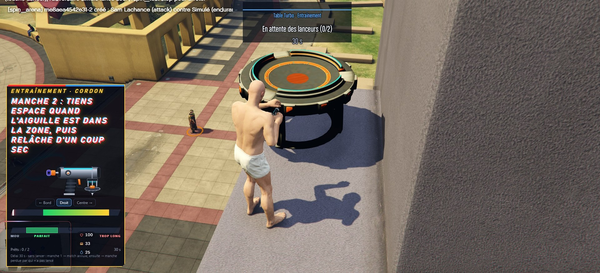
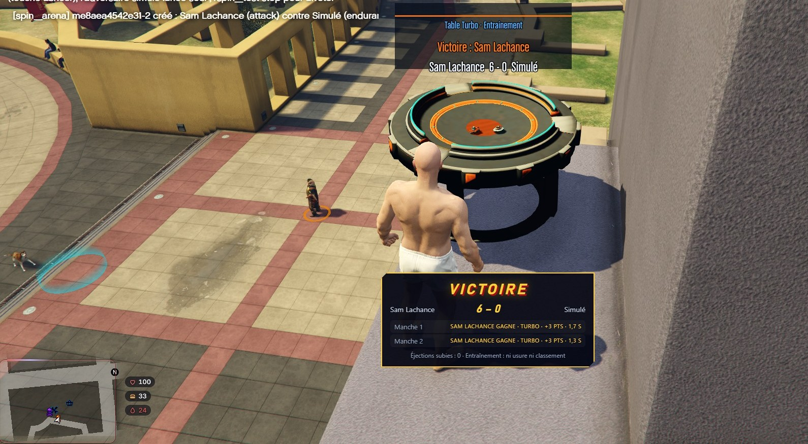
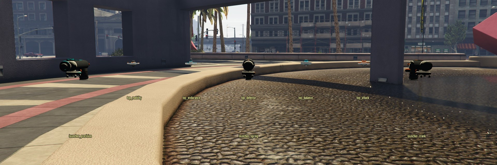

# ROTORBRAWL — édition gratuite

Combats de toupies mécaniques pour FiveM : l'assemblage de pièces, des duels décidés par le serveur, un classement par serveur.
Univers et noms originaux (aucune marque, aucun jouet existant). La ressource s'appelle `Chaos_Arena` ; « ROTORBRAWL » est un nom
de travail.

> **Édition gratuite.** Une édition **Pro** existe (tournois, matchs homologués avec certificat signé, tables Turbo / Poche /
> Colisée, arène transportable, quatre lanceurs de plus, trois pièces de plus).

## Captures (prises en jeu)

Les images montrent la version complète : la table **Turbo** et certains lanceurs (Manivelle, Ressort, Précision, Rail) sont réservés à l'édition Pro. L'édition gratuite a les tables Standard, Compacte, Éjection et Large, et le lanceur Cordon.


*Lancer en trois gestes : incliner, tenir ESPACE dans la zone, relâcher.*


*Fin d'un entraînement : score, manches et durée.*


*Galerie de test : les lanceurs et les cinq familles de toupies.*

## Ce qui est inclus
- Parcours **acheter → assembler → défier → combattre → réparer**.
- Duels 1 contre 1 : le serveur calcule tout, les clients affichent. Entraînement contre un adversaire simulé.
- Toupie à 4 pièces (Lame, Noyau, Verrou, Embout), 18 pièces, usure et réparation.
- Finitions de manche : Sortie, Arrêt, Éclat ; points par manche, premier à 4.
- Lanceur Cordon avec jauge de tirage, animation des deux mains.
- Tables Standard, Compacte, Éjection, Large ; arènes fixes placées par `/spin_admin arena add` ou par `arena.fixedList` dans
  `config/server.lua`.
- Boutique (ox_inventory), classement du serveur, interface NUI.
- Framework : **ESX Legacy testé en jeu** avec ox_inventory et ox_target. QBCore et Qbox sont pris en charge par le pont intégré (`bridge/`), avec qb-inventory ou qs-inventory (boutique et atelier par menus ; l'atelier par glisser-déposer exige ox_inventory) et qb-target, **mais ces configurations n'ont pas encore été testées en jeu** : signalez tout problème.

## Installation
1. Dépendances : `oxmysql`, `ox_lib`, un framework (ESX, QBCore ou Qbox), `ox_inventory`, `ox_target`. Le pont
   framework / inventaire est livré dans `bridge/` (fichiers ouverts, aucune autre ressource à installer).
2. Copier le dossier `Chaos_Arena` dans les ressources.
3. Ajouter les objets de `install/ox_inventory_items.lua` à ox_inventory et copier les images de `install/` dans
   `ox_inventory/web/images/`.
4. `server.cfg` :
   ```cfg
   ensure oxmysql
   ensure ox_lib
   ensure es_extended      # ou qb-core / qbx_core
   ensure ox_target
   ensure ox_inventory
   ensure Chaos_Arena
   add_ace group.admin command.spin_admin allow
   add_ace group.admin spin_arena.admin allow
   ```
5. La ressource crée ses tables SQL au démarrage (voir `sql/install.sql`). Sauvegarde avant toute migration.

## État honnête
Les modèles, la physique, l'interface et les animations ont été vérifiés hors jeu (moteur réel, émulateur, tests Lua/JS) et en
partie en jeu. Les points à contrôler sur ton serveur : échelle et orientation des modèles, animations du lanceur, positions de tes tables.

## Licence
`LICENSE` : modification autorisée, revente interdite, crédit obligatoire à AEOM Development. Les éléments de tiers (ESX, ox_*,
données GTA V) gardent leur licence ; ROTORBRAWL n'est affilié à aucun éditeur ni fabricant de jouets.
