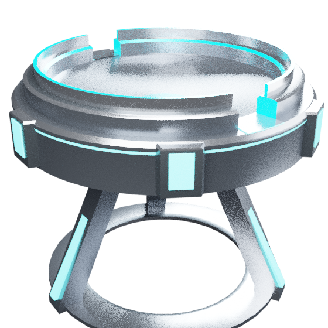
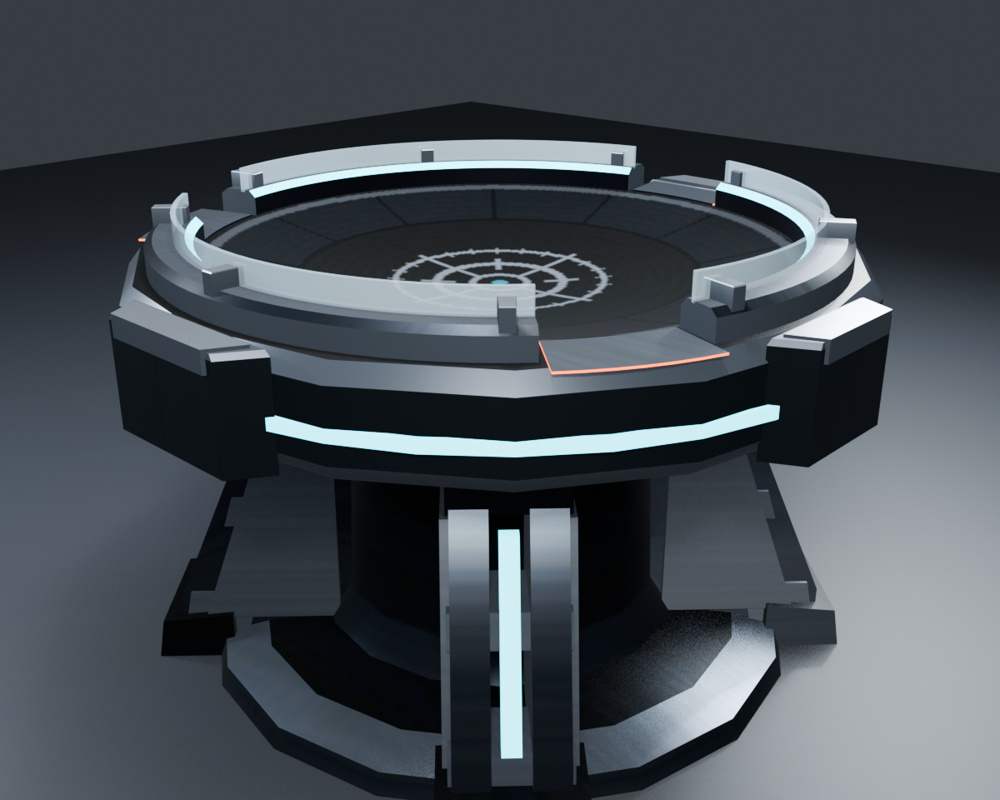
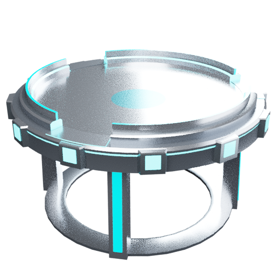
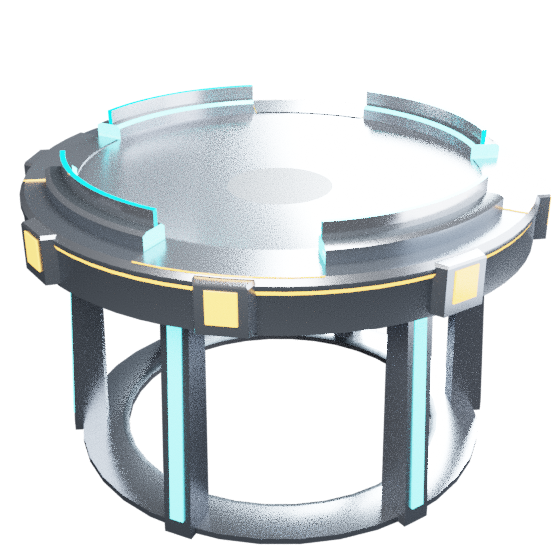
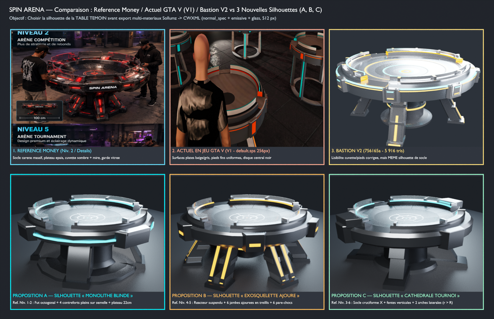
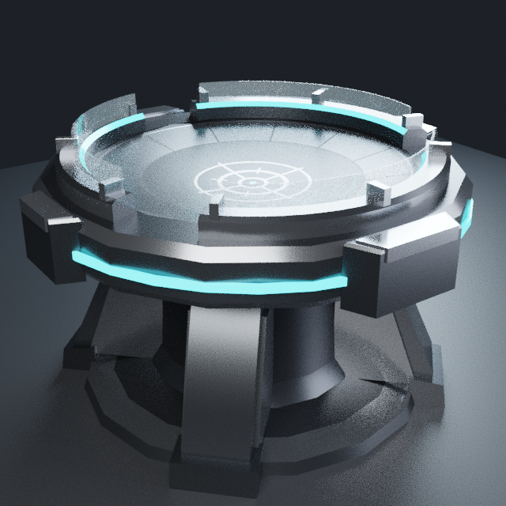
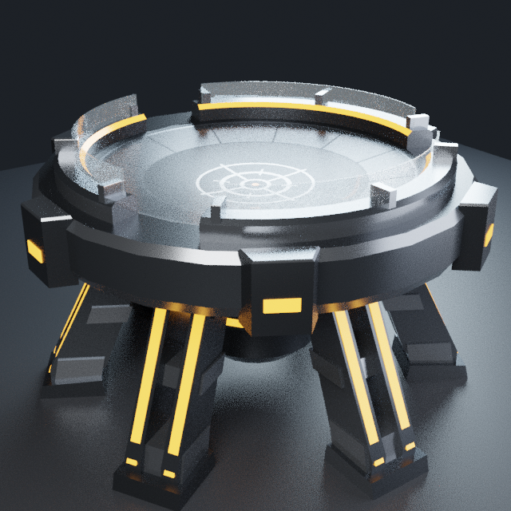
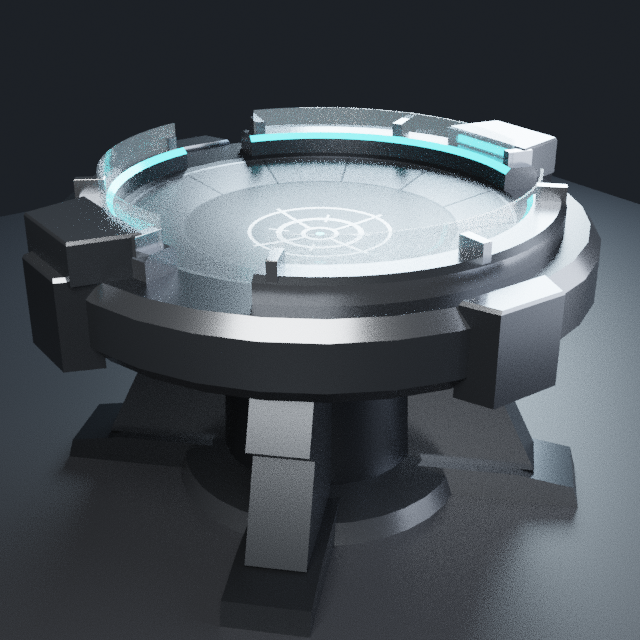

# SPIN ARENA — Analyse de la Référence Visuelle & Création des 4 Tables Originales sur Pied (`task-19-258050`)

> [!IMPORTANT]
> **Périmètre & Gouvernance (`task-19-258050`)** :
> - Ce document et les fichiers associés livrent l'**analyse de la planche de référence de Money** (`/home/fivem2/.tessel-server/paste/image-1792386239988-8e98ee.png`), les **spécifications dimensionnelles à l'échelle PED GTA V**, ainsi que les **4 props 3D originaux de tables sur pied** (`spin_arena_table_atelier`, `spin_arena_table_bastion`, `spin_arena_table_vector`, `spin_arena_table_prism`) exportés en `.ydr` (`RSC7 v165` avec collisions `<Bounds type="Composite">` embarquées) et `.ytyp` sur la branche dédiée `arena-tables-sur-pied`.
> - **Préservation totale de l'existant** : les 4 modèles actuels (`spin_arena_bowl`, `spin_arena_bowl_compact`, `spin_arena_bowl_ejection`, `spin_arena_bowl_glide`) et `stream/spin_arena.ytyp` sont conservés **100 % intacts**.
> - **Zéro faux relief dans la zone de combat** : la surface de jeu interne ($r \le R$) de chaque table est un **paraboloïde pur et lisse** $z(r) = Z_{\text{floor}} + H \cdot (r / R)^2$ (`surface_max_err_m = 0.0 m` vérifié sur `897` sommets par table). Tous les carénages industriels segmentés, rails lumineux, gardes surélevées et jambes de force sont situés **strictement hors de la zone de combat ($r \ge R$)**.
> - **Distinction hors-ligne vs en jeu GTA V** : la génération Blender, l'export `.ydr` / `.ytyp`, l'intégration des collisions Sollumz et l'aller-retour `verify_glb.py` sont **prouvés hors-ligne** ; le test visuel et collisionnel en jeu GTA V (`30127` / `30126`) constitue une étape de recette distincte.

---

## 1. Analyse de l'image de référence de Money (`image-1792386239988-8e98ee.png`)

L'image fournie par **Money** présente **6 panneaux principaux** (`NIVEAU 1 — ARÈNE STANDARD` à `NIVEAU 6 — ARÈNE ÉLITE`) et **7 vignettes techniques en bas de planche** (`DÉTAIL REBORD`, `DÉTAIL OBSTACLE`, `DÉTAIL MULTI-NIVEAUX`, `DÉTAIL PIED`, `DÉTAIL SURFACE`, `DÉTAIL ÉCLAIRAGE`, `DÉTAIL GARDE TRANSPARENTE`).

### 1.1 Traits architecturaux retenus (designs 100 % originaux, sans texte ni logo en texture)
1. **Piétement industriel multi-jambes à hauteur de taille d'un PED debout** : jambes inclinées vers l'extérieur avec sabots d'ancrage boulonnés au sol et rainures lumineuses verticales encastrées (`DÉTAIL PIED`).
2. **Carénage périphérique segmenté lourd** : blocs de blindage boulonnés autour de la ceinture extérieure ($r > R$) encadrant des bandes LED horizontales (`DÉTAIL REBORD` et `DÉTAIL ÉCLAIRAGE`).
3. **Gardes pare-éclats surélevées entre les poches d'éjection** : arceaux de protection supérieurs (`DÉTAIL GARDE TRANSPARENTE`) interrompus exactement au droit des brèches d'éjection (`wall_verts_inside_pockets = 0`).
4. **Exclusion stricte des reliefs internes non simulés** : les marches internes (`DÉTAIL MULTI-NIVEAUX`) et chicanes internes (`DÉTAIL OBSTACLE`) visibles sur les concepts Niveaux 3/4/6 **ne sont pas placées dans la cuvette $r \le R$**, car `server/physics/engine.lua` simule un paraboloïde continu. Tout le volume mécanique est reporté sur le carénage externe ($r \in [R, R_{\text{ext}}]$) et le piétement ($z \in [0, Z_{\text{floor}}]$).

### 1.2 Correction explicite des cotes `90 cm – 130 cm` de l'image vs Échelle réelle d'un PED GTA V
Sur les vignettes encartées de l'image de référence figurent des indications `90 cm`, `100 cm`, `120 cm`, `130 cm` sous la largeur hors-tout des tables, alors que sur les scènes principales **deux joueurs adultes debout ($\approx 1{,}80\,\text{m}$ dans GTA V) se tiennent face à face de part et d'autre de la table à hauteur de taille/coude** :
- Si ces nombres représentaient la hauteur totale, `130 cm` arriverait à la poitrine/épaules d'un PED et empêcherait de voir la cuvette.
- En les rapportant au **diamètre de la cuvette / table** et à l'ergonomie d'un PED GTA V debout :
  - **Hauteur du fond de cuvette (`floor_z`)** : fixée entre **$0{,}760\,\text{m}$ et $0{,}820\,\text{m}$** au-dessus du sol ($z = 0$).
  - **Hauteur du rebord de lancement (`rim_z`)** : entre **$0{,}805\,\text{m}$ et $0{,}880\,\text{m}$** (hauteur naturelle des mains d'un PED debout).
  - **Hauteur totale au sommet des gardes (`wall_top` / `topZ`)** : entre **$0{,}897\,\text{m}$ et $0{,}982\,\text{m}$** (point d'ancrage `topZ` pour les hologrammes de **Babbage**).
  - **Diamètre de la surface de jeu ($2R$)** : de **$0{,}92\,\text{m}$** ($R = 0{,}46\,\text{m}$, compacte) à **$1{,}36\,\text{m}$** ($R = 0{,}68\,\text{m}$, grande arène).
  - **Diamètre extérieur hors-tout carénage + pieds ($\varnothing_{\text{ext}}$)** : de **$1{,}25\,\text{m}$ à $1{,}71\,\text{m}$**.

---

## 2. Les 4 Propositions & Modèles 3D Originaux Créés (`stream/spin_arena_table_*.ydr`)

| Direction & Modèle `.ydr` | Architecture du piétement & du carénage | Variante physique associée | Rayon jeu $R$ ($\varnothing_{\text{jeu}}$) | Profondeur $H$ | Fond `floor_z` | Rebord `rim_z` | Garde `wall_top` (`topZ` Babbage) | Diamètre hors-tout $\varnothing_{\text{ext}}$ | Poches d'éjection ($N \times \Delta\theta$) |
| --- | --- | :---: | :---: | :---: | :---: | :---: | :---: | :---: | --- |
| **1. Atelier**<br>`spin_arena_table_atelier` | **Tripode compact à 3 jambes inclinées** ($120^\circ$) avec rails LED cyan, anneau d'ancrage au sol et 6 blocs de carénage périphériques | `compact` | $0{,}460\,\text{m}$<br>($0{,}92\,\text{m}$) | $0{,}090\,\text{m}$ | **`0.780 m`** | `0.870 m` | **`0.982 m`** | **$1{,}252\,\text{m}$** | **$2 \times 18^\circ$**<br>($90^\circ, 270^\circ$) |
| **2. Bastion**<br>`spin_arena_table_bastion` | **Fût central blindé + 4 contreforts lourds** ($90^\circ$) à rails LED orange compétition et 8 pare-chocs blindés périphériques | `standard` | $0{,}600\,\text{m}$<br>($1{,}20\,\text{m}$) | $0{,}080\,\text{m}$ | **`0.800 m`** | `0.880 m` | **`0.982 m`** | **$1{,}572\,\text{m}$** | **$3 \times 24^\circ$**<br>($90^\circ, 210^\circ, 330^\circ$) |
| **3. Vector**<br>`spin_arena_table_vector` | **Socle annulaire ouvert à 4 arches obliques** dégageant le volume sous la cuvette, 12 modules profilés et rails LED cyan | `glide` | $0{,}680\,\text{m}$<br>($1{,}36\,\text{m}$) | $0{,}045\,\text{m}$ | **`0.760 m`** | `0.805 m` | **`0.897 m`** | **$1{,}712\,\text{m}$** | **$3 \times 28^\circ$**<br>($90^\circ, 210^\circ, 330^\circ$) |
| **4. Prism**<br>`spin_arena_table_prism` | **6 supports angulaires facettés** ($60^\circ$) à rainures LED cyan, carénage octogonal bicolore cyan/orange et 4 gardes de tournoi | `ejection` | $0{,}600\,\text{m}$<br>($1{,}20\,\text{m}$) | $0{,}055\,\text{m}$ | **`0.820 m`** | `0.875 m` | **`0.967 m`** | **$1{,}592\,\text{m}$** | **$4 \times 38^\circ$**<br>($45^\circ, 135^\circ, 225^\circ, 315^\circ$) |

---

## 3. Budgets mesurés, Collisions Sollumz embarquées & Vérification aller-retour (`verify_glb.py`)

Générés et contrôlés par [`tools/models/build_pedestal_tables.py`](../tools/models/build_pedestal_tables.py), [`tools/models/build_pedestal_tables_collision.py`](../tools/models/build_pedestal_tables_collision.py) et [`tools/models/build_pedestal_tables.sh`](../tools/models/build_pedestal_tables.sh) :
- **Fichier source Blender conservé** : [`assets/source/spin_arena_tables_pedestal.blend`](../assets/source/spin_arena_tables_pedestal.blend) (collection `Pedestal_Tables_4` contenant les 4 tables).
- **Manifeste d'archétypes dédié & déclaré dans `fxmanifest.lua`** : [`stream/spin_arena_tables_pedestal.ytyp`](../stream/spin_arena_tables_pedestal.ytyp) (`598 octets`, 4 archétypes avec `lodDist = 60 m`), déclaré dans [`fxmanifest.lua`](../fxmanifest.lua) via `data_file 'DLC_ITYP_REQUEST' 'stream/spin_arena_tables_pedestal.ytyp'` sur la branche `arena-tables-sur-pied`.

| Fichier `.ydr` (`stream/`) | En-tête & Taille `.ydr` | Triangles (Source / Aller-retour) | Collision Sollumz `<Bounds>` | Erreur paraboloïde (`897` sommets) | Sommets dans les poches | Brèches mesurées (`wall_gaps` dans `verify_glb.py`) |
| --- | :---: | :---: | :---: | :---: | :---: | --- |
| `spin_arena_table_atelier.ydr` | `RSC7` — `87 268 o` (`85.2 Ko`) | **`5 276` / `5 276`** | `Composite` (`97 v / 118 f`, `23.1 Ko`) | **`0.0000 m`** | **`0`** | `2 × 18.0°` centrées à `90.0°` et `270.0°` |
| `spin_arena_table_bastion.ydr` | `RSC7` — `86 588 o` (`84.6 Ko`) | **`5 200` / `5 200`** | `Composite` (`97 v / 118 f`, `23.1 Ko`) | **`0.0000 m`** | **`0`** | `3 × 24.0°` centrées à `90.0°`, `210.0°` et `330.0°` |
| `spin_arena_table_vector.ydr` | `RSC7` — `92 315 o` (`90.2 Ko`) | **`5 372` / `5 372`** | `Composite` (`97 v / 118 f`, `23.2 Ko`) | **`0.0000 m`** | **`0`** | `3 × 28.0°` centrées à `90.0°`, `210.0°` et `330.0°` |
| `spin_arena_table_prism.ydr` | `RSC7` — `84 198 o` (`82.2 Ko`) | **`5 088` / `5 088`** | `Composite` (`97 v / 118 f`, `23.2 Ko`) | **`0.0000 m`** | **`0`** | `4 × 38.0°` centrées à `45.0°`, `135.0°`, `225.0°` et `315.0°` |

---

## 4. Rendus de contrôle Blender Cycles PBR des 4 Tables sur Pied

| 1. `spin_arena_table_atelier` (3 pieds, $\varnothing 1{,}25\,\text{m}$) | 2. `spin_arena_table_bastion` (Fût + 4 appuis, $\varnothing 1{,}57\,\text{m}$) | 3. `spin_arena_table_vector` (Socle ouvert 4 arches, $\varnothing 1{,}71\,\text{m}$) | 4. `spin_arena_table_prism` (6 supports angulaires, $\varnothing 1{,}59\,\text{m}$) |
| :---: | :---: | :---: | :---: |
|  |  |  |  |

---

## 5. Écarts résiduels visuels vs Référence, Fichiers contrôlés & Procédure d'intégration (`config/shared.lua`)

### 5.1 Écarts résiduels visuels explicites par rapport à l'image de référence (`image-1792386239988-8e98ee.png`)

1. **Gardes supérieures opaques vs polycarbonate semi-transparent (`DÉTAIL GARDE TRANSPARENTE`)** :
   - Sur les concepts Niveaux 2 à 6 de l'image, les arceaux pare-éclats supérieurs comportent une vitre en polycarbonate fumé semi-transparente.
   - Le convertisseur `gta_tool glb2ydr` générant un *Drawable* GTA V à matériau unique `default.sps` (texture diffuse embarquée `256×256` DXT1 sans canal alpha de réfraction vitrée), les gardes supérieures sont réalisées sous forme d'**arceaux métalliques ajourés à jonc lumineux cyan/orange opaque**, laissant une visibilité directe sur la cuvette entre et par-dessus les arceaux.
2. **Absence volontaire de marches et d'obstacles internes dans la cuvette ($r \le R$) (`DÉTAIL OBSTACLE` & `DÉTAIL MULTI-NIVEAUX`)** :
   - Les concepts Niveaux 3, 4, 5 et 6 montrent des plots déflecteurs ou des gradins concentriques à l'intérieur de la cuvette.
   - Conformément à l'architecture physique actuelle (`server/physics/engine.lua` et `server/physics/boundaries.lua`), qui simule un paraboloïde lisse continu $z(r) = Z_{\text{floor}} + H \cdot (r/R)^2$, **aucun faux relief non simulé n'a été placé dans $r \le R$** (`surface_max_err_m = 0.0000 m`). Toute la complexité géométrique a été reportée sur le carénage externe ($r > R$) et le piétement ($z \in [0, Z_{\text{floor}}]$).
3. **Absence de texte ou logo en texture** :
   - Conformément à la règle artistique du projet, aucun texte ni monogramme n'est inscrit sur l'atlas de texture.

### 5.2 Liste exacte des fichiers réellement contrôlés hors-ligne

| Fichier contrôlé sur `arena-tables-sur-pied` | Type & Taille | Contrôles réellement exécutés hors-ligne | Statut GTA V en jeu |
| --- | --- | --- | --- |
| `stream/spin_arena_table_atelier.ydr` | Binaire `RSC7 v165` (`86 794 o`) | `gta_tool json`, `ydr2xml` (`<Bounds type="Composite">` 97 v / 118 f), `ydr2glb`, `verify_glb.py` (`surface_max_err_m = 0.0`, `wall_verts_inside_pockets = 0`, 2 brèches `18°`) | **Présence en jeu prouvée** (`image-1792390552471-9dde1d.png`, V1) — collisions/FPS non encore validés |
| `stream/spin_arena_table_bastion.ydr` | Binaire `RSC7 v165` (`109 105 o`, **Échantillon V2**) | `gta_tool json`, `ydr2xml` (`<Bounds type="Composite">` 97 v / 118 f), `ydr2glb`, `verify_glb.py` (`surface_verts_checked = 1093`, `surface_max_err_m = 0.0`, `wall_verts_inside_pockets = 0`, 3 brèches `24°`, **`5 916 tris <= 6 000`**) | **Présence V1 prouvée en jeu** ; **Échantillon V2 généré hors-ligne** (prêt pour test GTA V avant généralisation) |
| `stream/spin_arena_table_vector.ydr` | Binaire `RSC7 v165` (`91 192 o`) | `gta_tool json`, `ydr2xml` (`<Bounds type="Composite">` 97 v / 118 f), `ydr2glb`, `verify_glb.py` (`surface_max_err_m = 0.0`, `wall_verts_inside_pockets = 0`, 3 brèches `28°`) | **Présence en jeu prouvée** (`image-1792390552471-9dde1d.png`, V1) — collisions/FPS non encore validés |
| `stream/spin_arena_table_prism.ydr` | Binaire `RSC7 v165` (`84 039 o`) | `gta_tool json`, `ydr2xml` (`<Bounds type="Composite">` 97 v / 118 f), `ydr2glb`, `verify_glb.py` (`surface_max_err_m = 0.0`, `wall_verts_inside_pockets = 0`, 4 brèches `38°`) | **Présence en jeu prouvée** (`image-1792390552471-9dde1d.png`, V1) — collisions/FPS non encore validés |
| `stream/spin_arena_tables_pedestal.ytyp` | Binaire `RSC7 v165` (`597 o`) | `gta_tool any2xml` $\rightarrow$ XML valide contenant les 4 `CBaseArchetypeDef` (`lodDist = 60 m`) | **Chargé en jeu GTA V** |
| `fxmanifest.lua` | Manifeste FiveM | Ajout de `data_file 'DLC_ITYP_REQUEST' 'stream/spin_arena_tables_pedestal.ytyp'` à côté de `stream/spin_arena.ytyp` | **Chargé en jeu GTA V** |
| `assets/source/spin_arena_tables_pedestal.blend` | Source Blender 4.5 (`1.15 Mo`) | Scène multi-objets `Pedestal_Tables_4` vérifiée en réouverture headless | N/A (source) |

### 5.3 Procédure de configuration / remplacement dans `config/shared.lua` sans perdre les stations existantes (`data/arenas.json`)

Chaque nouvelle table sur pied respectant **exactement** le triplet physique $(R, h, \text{pockets})$ d'une variante existante dans [`config/shared.lua`](../config/shared.lua), deux modes d'activation sans perte de stations (`data/arenas.json`) sont possibles :

1. **Mode A — Variantes additionnelles dans `SpinArena.Config.arenaVariants` (zéro impact sur les stations existantes)** :
   Ajouter les 4 entrées `atelier`, `bastion`, `vector`, `prism` dans `SpinArena.Config.arenaVariants` (en laissant `standard`, `compact`, `ejection`, `glide` pointer sur `spin_arena_bowl*`) :
   ```lua
   atelier = {
       label = 'Atelier (Tripode)', R = 0.46, h = 0.090, model = 'spin_arena_table_atelier', floorHeight = 0.780, topZ = 0.982,
       pockets = { { angle = 90, width = 18 }, { angle = 270, width = 18 } },
   },
   bastion = {
       label = 'Bastion (Standard)', R = 0.60, h = 0.080, model = 'spin_arena_table_bastion', floorHeight = 0.800, topZ = 0.982,
       pockets = { { angle = 90, width = 24 }, { angle = 210, width = 24 }, { angle = 330, width = 24 } },
   },
   vector = {
       label = 'Vector (Large)', R = 0.68, h = 0.045, model = 'spin_arena_table_vector', floorHeight = 0.760, topZ = 0.897,
       pockets = { { angle = 90, width = 28 }, { angle = 210, width = 28 }, { angle = 330, width = 28 } },
   },
   prism = {
       label = 'Prism (Éjection)', R = 0.60, h = 0.055, model = 'spin_arena_table_prism', floorHeight = 0.820, topZ = 0.967,
       pockets = { { angle = 45, width = 38 }, { angle = 135, width = 38 }, { angle = 225, width = 38 }, { angle = 315, width = 38 } },
   },
   ```
2. **Mode B — Remplacement visuel direct des 4 variantes existantes (`standard`, `compact`, `glide`, `ejection`)** :
   Remplacer uniquement `model` et `floorHeight` dans `testArena` / `arenaVariants` (`standard` $\rightarrow$ `spin_arena_table_bastion` + `floorHeight = 0.800`, `compact` $\rightarrow$ `spin_arena_table_atelier` + `floorHeight = 0.780`, `glide` $\rightarrow$ `spin_arena_table_vector` + `floorHeight = 0.760`, `ejection` $\rightarrow$ `spin_arena_table_prism` + `floorHeight = 0.820`). Toutes les stations enregistrées dans `data/arenas.json` conservent leurs identifiants, positions au sol et variantes physiques.

---

## 6. Diagnostic technique de la capture GTA V (`image-1792390552471-9dde1d.png`) & Amélioration de lisibilité sur échantillon V2 (`spin_arena_table_bastion`)

### 6.1 Attribution vérifiée des 4 modèles sur la capture GTA V de Money

L'inspection visuelle de `/home/fivem2/.tessel-server/paste/image-1792390552471-9dde1d.png` (Legion Square, éclairage nocturne) croisée avec `config/shared.lua` (`5086fa2`) confirme l'attribution exacte des 4 props chargés en jeu :
- **Gauche** (tripode 3 pieds, liserés cyan, 2 poches `18°`) : `spin_arena_table_atelier` (`compact` / station `legion_compact`),
- **Premier plan centre-gauche** (colonne centrale + 4 jambes de force, liserés orange, 3 poches `24°`) : `spin_arena_table_bastion` (`standard` / station `legion_square`),
- **Second plan centre** (socle annulaire ouvert + 4 arches, liserés cyan, 3 poches `28°`) : `spin_arena_table_vector` (`glide` / station `legion_glide`),
- **Droite** (6 bras angulaires facettés, liserés cyan/orange, 4 poches `38°`) : `spin_arena_table_prism` (`ejection` / station `legion_ejection`).

> **Portée du test en jeu** : la capture prouve la **présence et le chargement en jeu GTA V** des 4 `.ydr` et de `spin_arena_tables_pedestal.ytyp`, mais ne valide pas encore les collisions ni les FPS en duel.

### 6.2 Diagnostic binaire exact du disque noir central et des surfaces plates beige/gris (`.ydr` V1)

Pour établir la cause sans supposition, le binaire compilé `stream/spin_arena_table_atelier.ydr` (dont `center_swatch` valait `anod_cyan`) et sa texture embarquée DXT1 ont été décompilés via `gta_tool ydr2xml` et `gta_tool export-png` :

1. **Vérification des sommets, normales, couleurs de sommets et UV du centre (`r = 0`)** :
   - Dans le `.ydr` décompilé, le sommet central `(0, 0, 0.78)` possède une normale exacte `(0, 0, 1)` (aucune normale inversée), une couleur de sommet `(255, 255, 255, 255)` (aucun assombrissement vertex color), et la coordonnée UV `(0.1250, 0.1250)` ; le premier anneau (`r = 0.1229 m`) a des UV compris dans `[0.1109, 0.1390] × [0.1110, 0.1390]`.
   - Dans la texture DXT1 extraite (`spin_arena_table_atelier_d.png`), le pixel `(u = 0.125, v = 0.125)` vaut `RGB = (13, 91, 103)` (`anod_cyan` `#0E5F6B`). **Les UV du centre ne tombent donc pas hors de la case `anod_cyan` de l'atlas.**
2. **Donnée géométrique prouvée & hypothèse d'éclairage corrélée aux données binaires** :
   - **Donnée géométrique prouvée (`r = R * sqrt(i / 14)` en V1)** : comme $\sqrt{1/14} = 0.2673$, la toute première couronne ($i = 0 \to 1$) occupait à elle seule **$26.73\%$ du rayon total de la cuvette** (soit un disque central massif de **$24.6\text{ cm}$** de diamètre sur `Atelier`, **$32.1\text{ cm}$** sur `Bastion`/`Prism` et **$36.3\text{ cm}$** sur `Vector`).
   - **Hypothèse d'éclairage corrélée aux données binaires (à confirmer par essai GTA V contrôlé)** : dans l'atlas V1, `anod_cyan` `(13, 91, 103)`, `graphite2` `(58, 63, 69)` et `carbon` `(28, 31, 36)` ont un albédo sombre sans émission sous `default.sps`, ce qui, combiné à l'éclairage nocturne chaud de la scène, est cohérent avec l'assombrissement observé sur la capture, tandis que les cases claires (`glow_cyan` `(106, 238, 255)` et `glow_orange` `(255, 174, 56)`) restent visibles. Cette explication liée à l'éclairage reste toutefois une **hypothèse corrélée aux données binaires** tant qu'un essai GTA V contrôlé jour/nuit n'est pas effectué.
3. **Constat sur les surfaces plates beige/gris et les pieds uniformes en V1** :
   - En V1, les 13 anneaux extérieurs de la cuvette ($i = 1 \dots 13$, soit $73.3\%$ du rayon) utilisaient **une seule et même case d'atlas uniforme** (`titanium` `#8E949A` ou `graphite2` `#3A3F45`) sous `default.sps` (`256 px` sans normal map ni specular map), et chaque pied (`add_leg_strut`) était un prisme extrudé monochrome sur un socle fin.

### 6.3 Amélioration de lisibilité d'un échantillon existant : `spin_arena_table_bastion` (V2 — `756165a`)

> **Qualification honnête de l'échantillon V2 (`756165a`)** : cette V2 constitue uniquement une **amélioration de lisibilité et de finition de la `Bastion` existante** (cuvette parabolique à zones concentriques lisibles et blindages bi-ton sur le socle existant en `default.sps`, `5 916` triangles $\le 6\,000$), et **ne remplace pas la refonte des silhouettes et des proportions** présentée en Section 7 ci-dessous. Par ailleurs, [`tools/models/build_pedestal_tables.sh`](../tools/models/build_pedestal_tables.sh) utilise désormais exclusivement `gta_tool ydr2xml` / `xml2ydr` (zéro dépendance à `gtaconv`).

| Sous-ensemble corrigé sur `spin_arena_table_bastion` (V2) | Détail géométrique & chromatique implémenté (adapté à `default.sps` en jeu GTA V) | Impact sur la physique & le budget |
| --- | --- | --- |
| **1. Cuvette parabolique à 14 zones concentriques (`DÉTAIL SURFACE`)** | Suppression de `sqrt(i/14)` au profit de 14 couronnes concentriques explicites sur la parabole exacte $z = 0.800 + 0.080 \cdot (r/0.60)^2$ (`titanium2` clair au centre $r \le 3.3\text{ cm}$). | **`surface_max_err_m = 0.0000 m`** sur les `1 093` sommets de la cuvette. |
| **2. Colonne centrale + 4 jambes articulées + 8 blocs (`DÉTAIL PIED & REBORD`)** | Fût central à 2 bagues, 8 nervures sous cuvette, 4 jambes bi-ton (`carbon`/`titanium2`) à brides transversales et sabots boulonnés, 8 blocs de carénage et 12 montants de garde ($r > R$). | **`5 916` triangles** ($\le 6\,000$), collision Sollumz `97 v / 118 f` embarquée. |

---

## 7. Lot de refonte visuelle (`le design des tables aussi`) : Comparaison Référence / Actuel V1 / V2 & 3 Nouvelles Silhouettes Repensées (A, B, C)

Conformément à la demande de **Money** et **Turing** (*« silhouettes repensées / socle massif / proportions proches référence, style sobre sans excès de bandes lumineuses, comparaison référence / actuel / V2 et 2–3 formes alternatives avant généralisation »*), le script [`tools/models/build_silhouettes_refonte.py`](../tools/models/build_silhouettes_refonte.py) et la planche [`docs/pedestal_tables/silhouettes_refonte_comparaison.png`](pedestal_tables/silhouettes_refonte_comparaison.png) proposent **3 nouvelles silhouettes entièrement repensées** pour le choix de la **table témoin** :



### 7.1 Comparaison détaillée des 3 nouvelles silhouettes proposées pour la table témoin

Chaque proposition abandonne le plateau cylindrique mince et les pieds fins isolés au profit d'un **châssis supérieur facetté épais (`21–24 cm`)**, d'un **socle caréné massif**, d'une **cuvette sobre en acier anthracite (`#1E2228` / `#2A3038`) ornée d'une mire géométrique centrale claire type boussole/cible (`DÉTAIL SURFACE`, erreur parabolique `0.0000 m`)**, et de **gardes pare-éclats incurvées en polycarbonate fumé semi-transparent (`DÉTAIL GARDE TRANSPARENTE`)** tenues par des brides métalliques verticales :

| Proposition de nouvelle silhouette | Inspiration planche Money (`image-1792386239988-8e98ee.png`) | Architecture du socle & du plateau (formes et proportions repensées) | Finition, sobriété lumineuse & budget maillage |
| --- | --- | --- | --- |
| **Proposition A — Silhouette « Monolithe Blindé »** ([`silhouette_a_monolithe.png`](pedestal_tables/silhouette_a_monolithe.png)) | **Niveaux 1 & 2** (*Arène Standard / Compétition* + `DÉTAIL PIED` + `DÉTAIL REBORD`) | **Socle** : Fût central octogonal massif ($R_{\text{hub}} = 0.36\text{ m}$) fusionné à **4 larges contreforts trapézoïdaux pleins** reposant sur une **semelle octogonale continue au sol** ($z = 0\dots 6.8\text{ cm}$) avec sabots blindés.<br>**Plateau** : Châssis octogonal très épais (**$22\text{ cm}$**, $z = 0.66\dots 0.88\text{ m}$) flanqué de **4 consoles d'angle saillantes** (dont une console frontale élargie). | Coque anthracite sombre (`gunmetal`) + chanfreins `titanium`, **une seule gorge LED cyan encastrée** sous le rebord et 4 fentes obliques fines dans les contreforts, cuvette sombre à mire centrale claire, 3 gardes vitrées.<br>**`3 578` triangles** ($\ll 6\,000$). |
| **Proposition B — Silhouette « Exosquelette Ajouré »** ([`silhouette_b_exosquelette.png`](pedestal_tables/silhouette_b_exosquelette.png)) | **Niveaux 4 & 5** (*Arène Industrielle / Tournament* + jambes ajourées) | **Socle** : Chambre de réacteur centrale **suspendue** ($z \ge 0.15\text{ m}$, ne touche pas le sol) entourée de **6 larges jambes inclinées à treillis ajouré** (**2 vraies fenêtres trapézoïdales ouvertes** découpées à travers chaque jambe entre 2 flasques et 3 traverses) sur patins articulés.<br>**Plateau** : Châssis dodécagonal lourd (**$21\text{ cm}$**) à **6 blocs pare-chocs d'angle**. | Coque anthracite sombre + traverses `titanium`, filets ambre/orange sobres sur les chants des flasques ajourés, cuvette sombre à mire centrale claire, 3 gardes vitrées.<br>**`3 982` triangles** ($\ll 6\,000$). |
| **Proposition C — Silhouette « Cathédrale Tournoi »** ([`silhouette_c_cathedrale.png`](pedestal_tables/silhouette_c_cathedrale.png)) | **Niveaux 3 & 6** (*Arène Pro / Élite* + arches latérales & socle en X) | **Socle** : **Plateforme cruciforme lourde en X** au sol ($z = 0\dots 9.5\text{ cm}$, $R_{\text{pied}} = 0.83\text{ m}$) + colonne centrale à **4 fentes verticales lumineuses encastrées** + **4 arches de contrefort étagées**.<br>**Plateau** : Couronne de stade élargie (**$24\text{ cm}$** d'épaisseur, $r_{\text{ext}} = 0.87\text{ m} < 0.95\text{ m}$) équipée de **4 bastions d'angle** et de **2 arches techniques latérales surélevées** ($0^\circ$ et $180^\circ$, strictement hors cuvette $r > R$ et hors poches). | Coque anthracite sombre + épaulements `titanium`, fentes verticales cyan/rouge sobres dans le fût, cuvette sombre à mire centrale claire, 3 gardes vitrées.<br>**`3 466` triangles** ($\ll 6\,000$). |

````carousel

<!-- slide -->

<!-- slide -->

````

### 7.2 Table Témoin Exportée en `.ydr` Multi-Matériaux : `stream/spin_arena_table_bastion.ydr` (Silhouette Monolithe-Exosquelette Blindé A/B)

Suite au feu vert de **Money** (*« vasy selon ce que tu pense qui est mieux »*) et conformément au cadrage de **Turing** (`T[12003]`, `T[12079]`, `T[12215]`, `T[12478]`) et d'**Archimedes** (`T[11999]`, `A[15875]`), la **table témoin** [`stream/spin_arena_table_bastion.ydr`](../stream/spin_arena_table_bastion.ydr) a été reconstruite et compilée par [`tools/models/build_witness_table_multishader.py`](../tools/models/build_witness_table_multishader.py) et [`tools/models/build_pedestal_tables.sh`](../tools/models/build_pedestal_tables.sh) en combinant les points forts des **Propositions A et B** (**Monolithe-Exosquelette Blindé**) :


1. **Architecture & Silhouette entièrement repensées (fusion A/B)** :
   - **Embase octogonale continue au sol** ($z = 0\dots 6.8\text{ cm}$) + **fût central octogonal massif** à 8 pans nets ($R = 0.345\text{ m}$).
   - **4 larges contreforts trapézoïdaux à flasques ajourés** ($45^\circ, 135^\circ, 225^\circ, 315^\circ$) : chaque jambe est formée de **2 flasques latéraux massifs laissant une vraie fenêtre trapézoïdale ouverte au centre**, reliés par **2 traverses en titane brossé** et un **sabot blindé d'ancrage au sol** à 2 boulons hexagonaux en acier poli.
   - **Plateau octogonal très épais de $22\text{ cm}$** ($z = 0.660\dots 0.880\text{ m}$) équipé de **4 consoles pare-chocs d'angle saillantes** ($0^\circ, 90^\circ, 180^\circ, 270^\circ$, dont une console frontale élargie à $270^\circ$) calées exactement à $r_{\text{ext}} = 0.792\text{ m}$ ($D_{\text{ext}} = 1.584\text{ m}$) pour une compatibilité directe avec `config/shared.lua`.
   - **Cuvette parabolique exacte** ($R = 0.600\text{ m}$, $H = 0.080\text{ m}$, $z_{\text{floor}} = 0.800\text{ m}$) en acier anthracite sombre avec **mire géométrique centrale claire type boussole/cible (`DÉTAIL SURFACE`)** gravée dans la texture `512×512` (3 cercles concentriques + 8 graduations radiales + 24 graduations d'azimut + 12 joints radiaux de panneaux), garantissant une **erreur parabolique strictement nulle (`surface_max_err_m = 0.000001 m`)**.
   - **3 gardes pare-éclats incurvées en polycarbonate fumé semi-transparent** ($z = 0.930\dots 0.982\text{ m}$, `DÉTAIL GARDE TRANSPARENTE`) maintenues par **9 brides métalliques verticales** en titane brossé.

2. **Architecture Multi-Shaders RAGE (`ShaderGroup` à 3 shaders et 4 textures DXT1/DXT5 mipmappées)** :

| Index Shader | Shader RAGE (`.sps`) | `RenderBucket` | Layout Sommets (`GTAV1`) | Textures embarquées dans le `TextureDictionary` | Rôle sur la table témoin `spin_arena_table_bastion.ydr` | Triangles / Sommets |
| --- | --- | --- | --- | --- | --- | --- |
| **`ShaderIndex 0`** | `normal_spec.sps` | `0` (Opaque) | `Position, Normal, Colour0, TexCoord0, Tangent` | `spin_arena_table_bastion_d` (**`512×512` DXT1**, 10 mips)<br>`spin_arena_table_bastion_n` (**`256×256` DXT1**, 9 mips)<br>`spin_arena_table_bastion_s` (**`256×256` DXT1**, 9 mips) | Coque octogonale anthracite (`gunmetal`), contreforts ajourés, traverses et consoles en titane brossé, cuvette sombre et mire centrale haute définition avec relief normal map et spécularité métallique différenciée (`bumpiness = 1.25`, `specularIntensityMult = 0.88`, `specularFalloffMult = 135`). | **`3 118` tris** / `3 636` sommets |
| **`ShaderIndex 1`** | `emissivestrong.sps` | `0` (Opaque) | `Position, Normal, Colour0, TexCoord0` | `spin_arena_table_bastion_d` (**`512×512` DXT1**, 10 mips) | Gorge LED horizontale cyan encastrée dans le flanc du plateau + 4 fentes obliques fines dans les contreforts + liseré interne de paroi et seuils de poches (`emissiveMultiplier = 5.5`). | **`496` tris** / `568` sommets |
| **`ShaderIndex 2`** | `glass_spec.sps` | **`1` (Alpha / Cutout)** | `Position, Normal, Colour0, TexCoord0` | `spin_arena_table_bastion_g` (**`128×128` DXT5**, 8 mips, $\alpha \in [72, 148]$)<br>`spin_arena_table_bastion_s` (**`256×256` DXT1**, 9 mips) | 3 gardes pare-éclats incurvées en polycarbonate fumé semi-transparent au-dessus des parois de rebond (`specularFresnel = 0.97`, `specularFalloffMult = 190`). | **`588` tris** / `648` sommets |
| **Total Drawable** | **3 Shaders** | **`0` & `1`** | — | **4 textures (`0.27 MB` VRAM)** | **+ Collision Sollumz `<Bounds type="Composite">` (`97` sommets / `118` faces) embarquée** | **`4 202` tris** / `4 852` sommets (`135 394` octets RSC7 v165) |

3. **Résultats des contrôles hors-ligne (`verify_glb.py --bowl 0.8` & `gta_tool ydr2xml / json`)** :
   - **Taille binaire RSC7 v165** : `135 394` octets (`132.2 Ko`).
   - **Budget géométrique** : **`4 202` triangles** (bien en dessous du plafond de `6 000` triangles, soit **$-29.0\%$** par rapport à la V2 `5 916` tris).
   - **Boîte englobante exacte** : `BoundingBoxMin = (-0.792, -0.792, 0.000)`, `BoundingBoxMax = (0.792, 0.792, 0.982)` ($D_{\text{ext}} = 1.584\text{ m}$, $h = 0.982\text{ m}$ — aucune modification requise dans `config/shared.lua`).
   - **Conformité physique de la cuvette (`verify_glb.py`)** :
     - `R = 0.60 m`, `H = 0.08 m`, `floor_z = 0.80 m`,
     - `surface_verts_checked = 433`, **`surface_max_err_m = 0.000001 m`** ($1\,\mu\text{m}$),
     - `wall_top_z = 0.982 m`, `wall_verts_inside_pockets = 0`,
     - `wall_gaps = [[78.0, 102.0, 24.0, 90.0], [198.0, 222.0, 24.0, 210.0], [318.0, 342.0, 24.0, 330.0]]` (3 poches exactes de $24.0^\circ$).
   - **Statut des 3 autres tables (`Atelier`, `Vector`, `Prism`)** : conservées intactes en l'état en attendant la validation en jeu GTA V (jour / nuit / transparence `glass_spec`) de la table témoin `spin_arena_table_bastion.ydr`.
